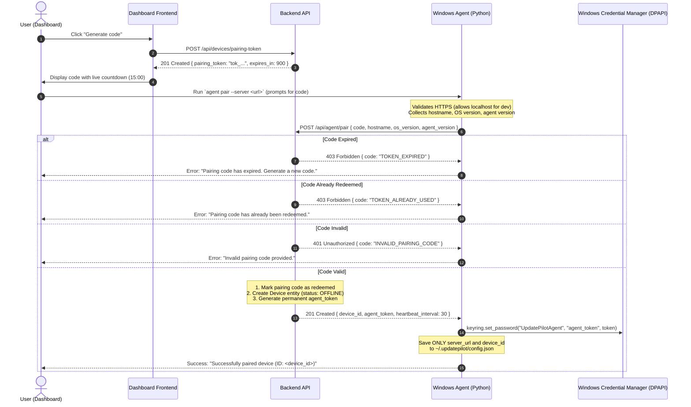
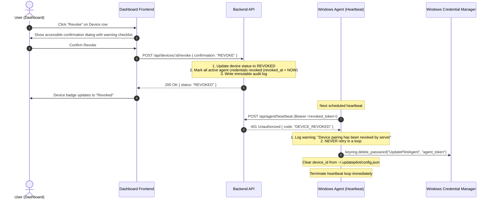

# UpdatePilot Agent Pairing & Security Guide

This document describes the cryptographic onboarding lifecycle, local secret storage architecture, heartbeat state machine, credential revocation protocol, and re-pairing procedures for the **UpdatePilot Windows Agent**.

---

## 1. Architecture Overview

UpdatePilot employs a dual-credential security architecture:
1. **Short-Lived Pairing Token**: Generated by an authenticated user in the web dashboard, valid for 15 minutes, single-use only.
2. **Permanent Agent Secret Token**: Generated by the backend upon successful pairing, cryptographically random (high-entropy), hashed via SHA-256 before storage on the backend, and stored securely on the host using the Windows Credential Manager.

```
+---------------------------------------------------------------------------------------------------------+
|                                        UpdatePilot Architecture                                         |
|                                                                                                         |
|   +--------------------+               +--------------------+               +-----------------------+   |
|   |   Web Dashboard    |               |    Backend API     |               |     Windows Host      |   |
|   |  (React Frontend)  |               |  (Node / Express)  |               |     (Python Agent)    |   |
|   +---------+----------+               +---------+----------+               +-----------+-----------+   |
|             |                                    |                                      |               |
|             | 1. Generate Pairing Code           |                                      |               |
|             |----------------------------------->|                                      |               |
|             |    POST /api/devices/pairing-token |                                      |               |
|             |<-----------------------------------|                                      |               |
|             |    { pairing_token: "tok_..." }    |                                      |               |
|             |                                    |                                      |               |
|             |                                    | 2. agent pair --server <url>         |               |
|             |                                    |    POST /api/agent/pair              |               |
|             |                                    |<-------------------------------------|               |
|             |                                    |    { code, hostname, os_version }    |               |
|             |                                    |                                      |               |
|             |                                    | 3. Redeem token & generate secret    |               |
|             |                                    |------------------------------------->|               |
|             |                                    |    { device_id, agent_token }        |               |
|             |                                    |                                      |               |
|             |                                    |                                      | 4. Save to    |
|             |                                    |                                      |    WinVault   |
|             |                                    |                                      +---------------+
+---------------------------------------------------------------------------------------------------------+
```

---

## 2. Pairing Sequence (End-to-End)

The sequence diagram below details the interaction across the Dashboard, Backend, Windows Agent, and Windows Credential Manager:



---

## 3. Where the Token is Stored

Zero plaintext authentication tokens or passwords are ever stored in configuration files or unencrypted storage.

### 3.1 Windows Credential Manager (Protected Secret Storage)
- **Library**: Python [`keyring`](https://github.com/jaraco/keyring) standard library package.
- **Backend**: `keyring.backends.Windows.WinVaultKeyring` (Windows Credential Manager / Credential Locker).
- **Protection**: Leverages the Windows Data Protection API (DPAPI) tied to the machine and user account security boundaries.
- **Service Name**: `UpdatePilotAgent`
- **Username / Account**: `agent_token`

### 3.2 Agent Configuration (`config.json`)
The local configuration file is located at:
- **Default Path**: `~/.updatepilot/config.json` (or `%LOCALAPPDATA%\UpdatePilot\config.json`).
- **Persisted Attributes**:
  ```json
  {
    "server_url": "https://dashboard.updatepilot.com",
    "device_id": "9b1deb4d-3b7d-4bad-9bdd-2b0d7b3dcb6d"
  }
  ```
- **Security Invariant**: Any attempt to save `token`, `code`, `pairing_token`, or `password` into `config.json` raises an immediate `ValueError` and halts execution.

---

## 4. Heartbeats & Online Telemetry

Once paired, the agent runs periodic heartbeats via:
```bash
agent run --interval 30
```

1. **Endpoint**: `POST /api/agent/heartbeat`
2. **Authentication Header**: `Authorization: Bearer <agent_token>`
3. **Payload**:
   ```json
   {
     "agent_version": "1.0.0",
     "os_version": "Windows 11 Home (Build 26200)",
     "hostname": "DESKTOP-DINUSHA"
   }
   ```
4. **Connection State Machine**:
   - The agent tracks internal connection state (`UNKNOWN`, `CONNECTED`, `LOST`).
   - State transition logs are emitted **only on state changes** (`connected`, `lost`, `restored`) to avoid log spamming.
   - On temporary network or HTTP failures, the agent applies exponential backoff with random jitter:
     $$\text{delay} = \min(60.0, 5.0 \times 2^{\text{retries}-1}) + \text{jitter}$$

---

## 5. Revocation Protocol & Decommissioning

Device authorization can be permanently revoked from the dashboard:



When a device is revoked:
1. The backend sets `device.status = "REVOKED"` and invalidates all token hashes.
2. The agent's very next heartbeat returns HTTP **`401 Unauthorized`**.
3. Upon receiving HTTP 401:
   - The agent **never retries in a loop**.
   - It purges the stored secret from Windows Credential Manager.
   - It clears `device_id` from `config.json`.
   - The daemon gracefully stops.

---

## 6. How to Re-Pair a Revoked Device

If a device was revoked and needs to reconnect:

1. **Generate a New Pairing Token**:
   - Navigate to **Settings & Agent** in the UpdatePilot web dashboard.
   - Under **Pair a new device**, click **Generate code**.
   - Note the new pairing code displayed on screen (e.g. `tok_3f92a11b89...`).

2. **Execute Agent Pairing**:
   - Open PowerShell or Windows Command Prompt.
   - Run:
     ```bash
     agent pair --server https://dashboard.updatepilot.com
     ```
   - When prompted (`Enter pairing code: `), paste the newly generated code. The input is hidden to prevent shell history leakage.
   - Or execute directly with the `--code` parameter:
     ```bash
     agent pair --server https://dashboard.updatepilot.com --code <new_pairing_code>
     ```

3. **Resume Agent Operation**:
   - Start the agent background daemon:
     ```bash
     agent run
     ```
   - Verify on the dashboard that the host appears with the **Online** status badge.
