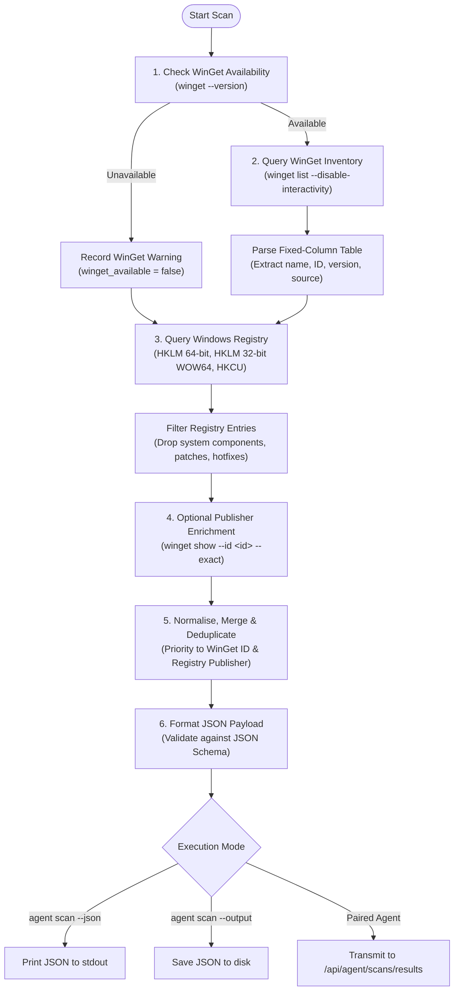

# UpdatePilot - Windows Agent Application Inventory Scanning

This document details the architecture, design rules, merging strategy, privacy boundaries, and CLI usage of the UpdatePilot Python Agent application scanner (`agent/scanner/`).

---

## 1. Scanner Architecture & Workflow

The scanner operates in **strictly read-only mode**. It never installs, modifies, or deletes software. It queries local inventory using two complementary data sources:
1. **Windows Package Manager (`winget`)**: Identifies managed packages, package IDs, sources, and available updates.
2. **Windows Registry Uninstall Keys**: Captures software installed via legacy Win32 installers (EXE/MSI) and user-level apps, serving as a reliable fallback.



---

## 2. Data Collected vs. Deliberately Not Collected

UpdatePilot enforces a strict privacy boundary. The agent collects only metadata necessary for software identification and update correlation.

| Field | Collected? | Description / Handling |
| :--- | :---: | :--- |
| **`name`** | **YES** | Display name of the application (normalized and trimmed). |
| **`version`** | **YES** | Installed version string (defaults to `"Unknown"` if missing). |
| **`publisher`** | **YES** | Software vendor/author from Registry or WinGet show. |
| **`package_id`** | **YES** | Standard WinGet manifest identifier (e.g. `Git.Git`) or synthetic ARP identifier. |
| **`source`** | **YES** | Discovery origin: `"winget"`, `"registry"`, or `"both"`. |
| **`is_managed`** | **YES** | Boolean indicating if package can be updated via WinGet/MSStore. |
| **File Paths** | **NO** | `InstallLocation`, binary paths, and DLL locations are **deliberately dropped**. |
| **Usernames** | **NO** | No Windows user accounts, SIDs, or profile paths are collected. |
| **Uninstall Strings** | **NO** | `UninstallString` and silent arguments are never read or stored. |
| **Environment Variables**| **NO** | No system or user environment variables are collected during scans. |

---

## 3. WinGet & Registry Merging Strategy

WinGet and Registry inventory entries are merged and deduplicated using strict precedence rules:

1. **Identifier Matching**:
   - If both records contain an identical `package_id`, they are treated as the same application.
2. **Fuzzy Fallback Matching**:
   - If one or both lack a standard `package_id`, entries are matched using a **normalized comparison key**:
     - Lowercase and collapse multiple spaces.
     - Strip architecture qualifiers (`(x64)`, `(86)`, `64-bit`, `32-bit`, `arm64`).
     - Strip OS wrappers (`for Windows`).
     - Strip non-alphanumeric punctuation.
   - If normalized name and normalized version match, they are merged.
3. **Conflict Resolution & Precedence**:
   - **Package ID**: WinGet's `package_id` takes precedence (enables automated upgrade discovery).
   - **Publisher**: Registry's verified `Publisher` string takes precedence over derived WinGet vendor prefixes.
   - **Source**: Set to `"both"` for merged items; remains `"winget"` or `"registry"` for unmerged items.
4. **Deduplication**:
   - Identical applications found in multiple registry hives (such as both 64-bit and 32-bit WOW64 nodes) are collapsed into a single entry.
   - All results are sorted alphabetically by application name (case-insensitive).

---

## 4. Known Limitations & Edge Cases

1. **Truncated Names (`…` or `...`)**:
   - In standard console buffers, WinGet truncates wide application names with ellipses. The scanner records the raw string in `raw_name` and trims trailing ellipses in `name`.
2. **Unmanaged Applications (ARP & MSIX Synthetic IDs)**:
   - Applications installed outside package managers appear in WinGet with IDs like `ARP\Machine\X86\...` or MSI product GUIDs (`{GUID}`). The scanner marks these as `is_managed: false`. They appear in the inventory dashboard for system visibility but cannot be upgraded automatically.
3. **Console Encoding & Wide Characters**:
   - PowerShell redirections and non-ASCII application titles (such as Japanese, Chinese, or Cyrillic characters) can distort fixed-width string slicing. The scanner uses `unicodedata.east_asian_width` to calculate visual terminal cell widths rather than byte/character lengths.
4. **Missing or Elevated Registry Keys**:
   - Certain protected registry keys require administrator elevation. If permission is denied (`WinError 5`), the scanner catches the error, appends it to `warnings`, and continues without aborting the scan.

---

## 5. Running the Scanner via CLI

The scanner can be executed locally without connecting to or registering with the backend server.

### 5.1 Output JSON to Terminal
```bash
python -m agent.cli scan --json
```

### 5.2 Save Scan Results to File
```bash
python -m agent.cli scan --output ./inventory.json
```

### 5.3 Sample JSON Output
```json
{
  "exit_code": 0,
  "discovered_packages": [
    {
      "name": "7-Zip 24.09 (x64)",
      "package_id": "7zip.7zip",
      "installed_version": "24.09",
      "available_version": null,
      "source": "both",
      "is_managed": true,
      "publisher": "Igor Pavlov"
    },
    {
      "name": "Git for Windows",
      "package_id": "Git.Git",
      "installed_version": "2.50.0.2",
      "available_version": null,
      "source": "both",
      "is_managed": true,
      "publisher": "The Git Development Community"
    }
  ],
  "available_upgrades": [],
  "raw_stderr": ""
}
```
