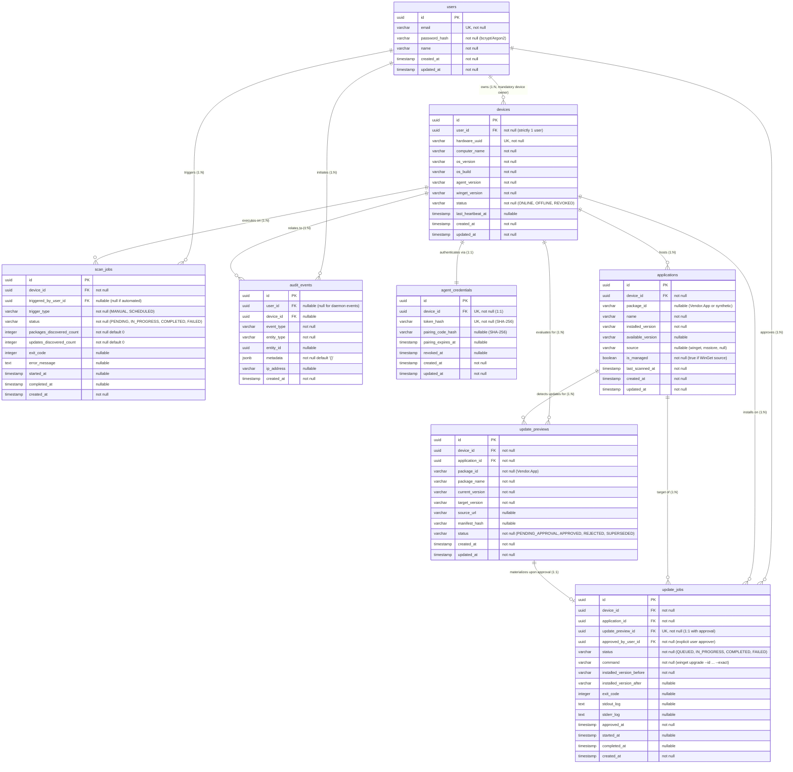

# UpdatePilot - Database Architecture & Schema Specification

This document defines the relational database schema, entity relationships, security constraints, and data integrity rules for **UpdatePilot**.

---

## 1. Entity-Relationship Diagram (ERD)

---

## 2. Entity Tables & Schema Specifications

> [!IMPORTANT]
> ### Zero Plaintext Credentials: Hash Storage Policy
> The following security-sensitive fields **strictly store cryptographic hashes only** and **never** store plaintext passwords or tokens:
> - **`users.password_hash`**: Stores salted bcrypt (work factor >= 12) or Argon2id hashes. Raw passwords are never persisted or logged.
> - **`agent_credentials.token_hash`**: Stores SHA-256 hashes of permanent agent device authentication secrets. The raw token is only returned to the agent once during pairing and never stored in the database.
> - **`agent_credentials.pairing_code_hash`**: Stores SHA-256 hashes of short-lived pairing tokens. Raw pairing codes are never persisted in the database.

---

### 2.1 `users`
Dashboard operators and administrative accounts.

| Column | Data Type | Nullable | Constraints & Defaults | Indexes | Description |
| :--- | :--- | :---: | :--- | :--- | :--- |
| **`id`** | `UUID` | No | `PRIMARY KEY`, `DEFAULT gen_random_uuid()` | PK Index | Unique user identifier. |
| **`email`** | `VARCHAR(255)` | No | `UNIQUE` | `idx_users_email` (Unique) | User login email (case-insensitive lookup). |
| **`password_hash`** | `VARCHAR(255)` | No | *(None)* | *(None)* | **Hash Only**: bcrypt/Argon2 salted password hash. |
| **`name`** | `VARCHAR(100)` | No | *(None)* | *(None)* | Human-readable user display name. |
| **`created_at`** | `TIMESTAMPTZ` | No | `DEFAULT NOW()` | `idx_users_created_at` | Record creation timestamp. |
| **`updated_at`** | `TIMESTAMPTZ` | No | `DEFAULT NOW()` | *(None)* | Automatic row update timestamp. |

---

### 2.2 `devices`
Registered Windows PC endpoints. Every device strictly belongs to exactly one user.

| Column | Data Type | Nullable | Constraints & Defaults | Indexes | Description |
| :--- | :--- | :---: | :--- | :--- | :--- |
| **`id`** | `UUID` | No | `PRIMARY KEY`, `DEFAULT gen_random_uuid()` | PK Index | Unique device identifier. |
| **`user_id`** | `UUID` | No | `FOREIGN KEY (user_id) REFERENCES users(id) ON DELETE RESTRICT` | `idx_devices_user_id` | **Mandatory 1:1 owner link**. Enforces single-user device ownership. |
| **`hardware_uuid`** | `VARCHAR(128)` | No | `UNIQUE` | `idx_devices_hardware_uuid` (Unique) | BIOS / Motherboard UUID (`Win32_ComputerSystemProduct.UUID`). |
| **`computer_name`** | `VARCHAR(100)` | No | *(None)* | `idx_devices_computer_name` | Windows hostname (e.g., `DESKTOP-DINUSHA`). |
| **`os_version`** | `VARCHAR(100)` | No | *(None)* | *(None)* | Windows OS Edition (e.g., `Windows 11 Home`). |
| **`os_build`** | `VARCHAR(50)` | No | *(None)* | *(None)* | Windows build number (e.g., `26200`). |
| **`agent_version`** | `VARCHAR(30)` | No | *(None)* | *(None)* | Installed Python agent version string. |
| **`winget_version`** | `VARCHAR(30)` | No | *(None)* | *(None)* | Discovered WinGet CLI version (`v1.29.380`). |
| **`status`** | `VARCHAR(30)` | No | `CHECK (status IN ('ONLINE', 'OFFLINE', 'REVOKED')) DEFAULT 'OFFLINE'` | `idx_devices_status` | Connection lifecycle state. |
| **`last_heartbeat_at`** | `TIMESTAMPTZ` | Yes | *(None)* | `idx_devices_last_heartbeat` | Timestamp of last received agent heartbeat ping. |
| **`created_at`** | `TIMESTAMPTZ` | No | `DEFAULT NOW()` | *(None)* | Pairing enrollment timestamp. |
| **`updated_at`** | `TIMESTAMPTZ` | No | `DEFAULT NOW()` | *(None)* | Timestamp of last metadata or heartbeat change. |

---

### 2.3 `agent_credentials`
Cryptographic authentication credentials and pairing tokens for Windows agents.

| Column | Data Type | Nullable | Constraints & Defaults | Indexes | Description |
| :--- | :--- | :---: | :--- | :--- | :--- |
| **`id`** | `UUID` | No | `PRIMARY KEY`, `DEFAULT gen_random_uuid()` | PK Index | Unique credential identifier. |
| **`device_id`** | `UUID` | No | `UNIQUE`, `FOREIGN KEY (device_id) REFERENCES devices(id) ON DELETE CASCADE` | `idx_agent_cred_device_id` (Unique) | 1:1 binding between device and credential record. |
| **`token_hash`** | `VARCHAR(128)` | No | `UNIQUE` | `idx_agent_cred_token_hash` (Unique) | **Hash Only**: SHA-256 hash of permanent agent API secret token. |
| **`pairing_code_hash`** | `VARCHAR(128)` | Yes | *(None)* | `idx_agent_cred_pairing_hash` | **Hash Only**: SHA-256 hash of one-time pairing key. |
| **`pairing_expires_at`** | `TIMESTAMPTZ` | Yes | *(None)* | `idx_agent_cred_pairing_exp` | Pairing key expiry (15-minute window). |
| **`revoked_at`** | `TIMESTAMPTZ` | Yes | *(None)* | `idx_agent_cred_revoked_at` | Revocation timestamp; null if active. |
| **`created_at`** | `TIMESTAMPTZ` | No | `DEFAULT NOW()` | *(None)* | Record generation timestamp. |
| **`updated_at`** | `TIMESTAMPTZ` | No | `DEFAULT NOW()` | *(None)* | Timestamp of last credential update. |

---

### 2.4 `applications`
Software packages installed on Windows endpoints, cataloged via `winget list`.

| Column | Data Type | Nullable | Constraints & Defaults | Indexes | Description |
| :--- | :--- | :---: | :--- | :--- | :--- |
| **`id`** | `UUID` | No | `PRIMARY KEY`, `DEFAULT gen_random_uuid()` | PK Index | Unique application entry identifier. |
| **`device_id`** | `UUID` | No | `FOREIGN KEY (device_id) REFERENCES devices(id) ON DELETE CASCADE` | `idx_applications_device_id` | Host device running the software. |
| **`package_id`** | `VARCHAR(255)` | Yes | *(None)* | `idx_applications_package_id` | WinGet package ID (e.g. `Git.Git`) or synthetic ARP identifier. |
| **`name`** | `VARCHAR(255)` | No | *(None)* | `idx_applications_name` | Display name of the application. |
| **`installed_version`** | `VARCHAR(100)` | No | *(None)* | *(None)* | Version string reported by host. |
| **`available_version`** | `VARCHAR(100)` | Yes | *(None)* | *(None)* | Target version available in WinGet catalogs. |
| **`source`** | `VARCHAR(50)` | Yes | *(None)* | `idx_applications_source` | Catalog source (`winget`, `msstore`, or `NULL`). |
| **`is_managed`** | `BOOLEAN` | No | `DEFAULT FALSE` | `idx_applications_is_managed` | `TRUE` if package has a verified WinGet catalog source. |
| **`last_scanned_at`** | `TIMESTAMPTZ` | No | `DEFAULT NOW()` | *(None)* | Timestamp when last confirmed on host. |
| **`created_at`** | `TIMESTAMPTZ` | No | `DEFAULT NOW()` | *(None)* | Discovery timestamp. |
| **`updated_at`** | `TIMESTAMPTZ` | No | `DEFAULT NOW()` | *(None)* | Record update timestamp. |

#### Constraints & Search Indexes for `applications`:
- **Unique Constraint (`uq_device_package_id`)**: `UNIQUE (device_id, package_id)` enforces that a device cannot have duplicate records for the same WinGet package.
- **Application Search Indexes**:
  - `idx_apps_search_name`: `INDEX (device_id, name)` accelerates prefix and substring filtering in dashboard search.
  - `idx_apps_device_managed`: `INDEX (device_id, is_managed)` accelerates the "Supported vs. Unsupported" table filter.
  - `idx_apps_device_source`: `INDEX (device_id, source)` accelerates source dropdown filtering (`winget`, `msstore`).

---

### 2.5 `scan_jobs`
Inventory scans executed on Windows devices.

| Column | Data Type | Nullable | Constraints & Defaults | Indexes | Description |
| :--- | :--- | :---: | :--- | :--- | :--- |
| **`id`** | `UUID` | No | `PRIMARY KEY`, `DEFAULT gen_random_uuid()` | PK Index | Unique scan job identifier. |
| **`device_id`** | `UUID` | No | `FOREIGN KEY (device_id) REFERENCES devices(id) ON DELETE CASCADE` | `idx_scan_jobs_device_id` | Target device scanned. |
| **`triggered_by_user_id`** | `UUID` | Yes | `FOREIGN KEY (triggered_by_user_id) REFERENCES users(id) ON DELETE SET NULL` | `idx_scan_jobs_user_id` | User who clicked "Scan now" (null if scheduled). |
| **`trigger_type`** | `VARCHAR(30)` | No | `CHECK (trigger_type IN ('MANUAL', 'SCHEDULED')) DEFAULT 'MANUAL'` | *(None)* | Trigger source. |
| **`status`** | `VARCHAR(30)` | No | `CHECK (status IN ('PENDING', 'IN_PROGRESS', 'COMPLETED', 'FAILED')) DEFAULT 'PENDING'` | `idx_scan_jobs_status` | Job execution progress status. |
| **`packages_discovered_count`** | `INTEGER` | No | `DEFAULT 0` | *(None)* | Total packages parsed from `winget list`. |
| **`updates_discovered_count`** | `INTEGER` | No | `DEFAULT 0` | *(None)* | Total updates parsed from `winget upgrade`. |
| **`exit_code`** | `INTEGER` | Yes | *(None)* | *(None)* | WinGet subprocess exit code (`0`, `0x8A15002B`, etc.). |
| **`error_message`** | `TEXT` | Yes | *(None)* | *(None)* | Captured stderr or timeout message if failed. |
| **`started_at`** | `TIMESTAMPTZ` | Yes | *(None)* | *(None)* | Subprocess execution start timestamp. |
| **`completed_at`** | `TIMESTAMPTZ` | Yes | *(None)* | *(None)* | Subprocess completion timestamp. |
| **`created_at`** | `TIMESTAMPTZ` | No | `DEFAULT NOW()` | `idx_scan_jobs_created_at` | Job dispatch request timestamp. |

---

### 2.6 `update_previews`
Staged software updates discovered during scans awaiting human review.

| Column | Data Type | Nullable | Constraints & Defaults | Indexes | Description |
| :--- | :--- | :---: | :--- | :--- | :--- |
| **`id`** | `UUID` | No | `PRIMARY KEY`, `DEFAULT gen_random_uuid()` | PK Index | Unique preview identifier. |
| **`device_id`** | `UUID` | No | `FOREIGN KEY (device_id) REFERENCES devices(id) ON DELETE CASCADE` | `idx_previews_device_id` | Target host machine. |
| **`application_id`** | `UUID` | No | `FOREIGN KEY (application_id) REFERENCES applications(id) ON DELETE CASCADE` | `idx_previews_app_id` | Linked inventory application. |
| **`package_id`** | `VARCHAR(255)` | No | *(None)* | `idx_previews_package_id` | Canonical WinGet ID (e.g. `Git.Git`). |
| **`package_name`** | `VARCHAR(255)` | No | *(None)* | *(None)* | Human-friendly software name. |
| **`current_version`** | `VARCHAR(100)` | No | *(None)* | *(None)* | Installed version before upgrade. |
| **`target_version`** | `VARCHAR(100)` | No | *(None)* | *(None)* | Higher version available in WinGet source. |
| **`source_url`** | `VARCHAR(500)` | Yes | *(None)* | *(None)* | Link to upstream manifest repository. |
| **`manifest_hash`** | `VARCHAR(128)` | Yes | *(None)* | *(None)* | Installer package SHA-256 hash. |
| **`status`** | `VARCHAR(30)` | No | `CHECK (status IN ('PENDING_APPROVAL', 'APPROVED', 'REJECTED', 'SUPERSEDED')) DEFAULT 'PENDING_APPROVAL'` | `idx_previews_status` | Current approval lifecycle state. |
| **`created_at`** | `TIMESTAMPTZ` | No | `DEFAULT NOW()` | `idx_previews_created_at` | Discovery timestamp. |
| **`updated_at`** | `TIMESTAMPTZ` | No | `DEFAULT NOW()` | *(None)* | Approval/rejection timestamp. |

#### Constraints & Indexes for `update_previews`:
- **Unique Pending Update Constraint (`uq_device_pkg_pending`)**: Ensures that a device only has at most one active `PENDING_APPROVAL` record for a specific `package_id`.
- **Query Index**: `idx_previews_device_status`: `INDEX (device_id, status)` optimizes the dashboard Updates screen query (`WHERE device_id = ? AND status = 'PENDING_APPROVAL'`).

---

### 2.7 `update_jobs`
Authorized update execution tasks dispatched to Windows agents.
> **Cardinal Invariant**: Every `update_job` must reference an explicit `approved_by_user_id`. No automated update execution without user authorization is permitted.

| Column | Data Type | Nullable | Constraints & Defaults | Indexes | Description |
| :--- | :--- | :---: | :--- | :--- | :--- |
| **`id`** | `UUID` | No | `PRIMARY KEY`, `DEFAULT gen_random_uuid()` | PK Index | Unique update job identifier. |
| **`device_id`** | `UUID` | No | `FOREIGN KEY (device_id) REFERENCES devices(id) ON DELETE CASCADE` | `idx_update_jobs_device_id` | Target device where agent runs. |
| **`application_id`** | `UUID` | No | `FOREIGN KEY (application_id) REFERENCES applications(id) ON DELETE CASCADE` | `idx_update_jobs_app_id` | Application being upgraded. |
| **`update_preview_id`** | `UUID` | No | `UNIQUE, FOREIGN KEY (update_preview_id) REFERENCES update_previews(id) ON DELETE RESTRICT` | `idx_update_jobs_preview_id` (Unique) | 1:1 link to the approved preview record. |
| **`approved_by_user_id`** | `UUID` | No | `FOREIGN KEY (approved_by_user_id) REFERENCES users(id) ON DELETE RESTRICT` | `idx_update_jobs_user_id` | **Mandatory user authorizer ID**. |
| **`status`** | `VARCHAR(30)` | No | `CHECK (status IN ('QUEUED', 'IN_PROGRESS', 'COMPLETED', 'FAILED')) DEFAULT 'QUEUED'` | `idx_update_jobs_status` | Real-time execution status. |
| **`command`** | `VARCHAR(500)` | No | *(None)* | *(None)* | Sanitized command array representation. |
| **`installed_version_before`** | `VARCHAR(100)` | No | *(None)* | *(None)* | Baseline version prior to execution. |
| **`installed_version_after`** | `VARCHAR(100)` | Yes | *(None)* | *(None)* | Post-upgrade verified version. |
| **`exit_code`** | `INTEGER` | Yes | *(None)* | `idx_update_jobs_exit_code` | Installer exit code (`0` = Success, `1603` = Failure). |
| **`stdout_log`** | `TEXT` | Yes | *(None)* | *(None)* | Captured standard output from installer. |
| **`stderr_log`** | `TEXT` | Yes | *(None)* | *(None)* | Captured standard error trace from installer. |
| **`approved_at`** | `TIMESTAMPTZ` | No | `DEFAULT NOW()` | *(None)* | Exact timestamp of user approval click. |
| **`started_at`** | `TIMESTAMPTZ` | Yes | *(None)* | *(None)* | Agent command launch timestamp. |
| **`completed_at`** | `TIMESTAMPTZ` | Yes | *(None)* | *(None)* | Agent execution finished timestamp. |
| **`created_at`** | `TIMESTAMPTZ` | No | `DEFAULT NOW()` | `idx_update_jobs_created_at` | Record creation timestamp. |

#### Indexes for `update_jobs`:
- `idx_update_jobs_polling`: `INDEX (device_id, status)` for high-frequency agent polling of `QUEUED` approved tasks.
- `idx_update_jobs_device_created`: `INDEX (device_id, created_at DESC)` for rendering the History screen timeline.

---

### 2.8 `audit_events`
Immutable security and operational event log. Append-only ledger.

| Column | Data Type | Nullable | Constraints & Defaults | Indexes | Description |
| :--- | :--- | :---: | :--- | :--- | :--- |
| **`id`** | `UUID` | No | `PRIMARY KEY`, `DEFAULT gen_random_uuid()` | PK Index | Unique audit event identifier. |
| **`user_id`** | `UUID` | Yes | `FOREIGN KEY (user_id) REFERENCES users(id) ON DELETE SET NULL` | `idx_audit_user_id` | User who performed action (null for agent/system). |
| **`device_id`** | `UUID` | Yes | `FOREIGN KEY (device_id) REFERENCES devices(id) ON DELETE CASCADE` | `idx_audit_device_id` | Affected device. |
| **`event_type`** | `VARCHAR(50)` | No | *(None)* | `idx_audit_event_type` | Action identifier (e.g. `UPDATE_APPROVED`, `UPDATE_COMPLETED`). |
| **`entity_type`** | `VARCHAR(50)` | No | *(None)* | `idx_audit_entity_type` | Target table (`UPDATE_JOB`, `DEVICE`, `USER`). |
| **`entity_id`** | `UUID` | Yes | *(None)* | `idx_audit_entity_id` | Target row UUID. |
| **`metadata`** | `JSONB` | No | `DEFAULT '{}'` | `idx_audit_metadata` (GIN) | Rich context: version deltas, exit codes, IP address, user-agent. |
| **`ip_address`** | `VARCHAR(45)` | Yes | *(None)* | *(None)* | Origin client IP address (IPv4 or IPv6). |
| **`created_at`** | `TIMESTAMPTZ` | No | `DEFAULT NOW()` | `idx_audit_created_at` | Immutable event timestamp. |

#### Indexes for `audit_events`:
- `idx_audit_device_timeline`: `INDEX (device_id, created_at DESC)` optimizes the device audit log timeline.
- `idx_audit_metadata_gin`: `GIN INDEX (metadata)` enables fast JSON query inspection over exit codes and package IDs.

---

## 3. Data Integrity Constraints Summary

1. **Strict 1:1 Device-User Isolation**:
   - `devices.user_id` is mandatory (`NOT NULL`) with `ON DELETE RESTRICT` to ensure a device can never exist without an owning user.
   - All tenant queries are scoped by `user_id = current_user.id`.

2. **Deduplication Constraints**:
   - `applications(device_id, package_id)`: Prevents multiple rows for the same installed package on a single machine.
   - `devices(hardware_uuid)`: Prevents duplicate device registrations for the same physical motherboard/BIOS UUID.
   - `agent_credentials(device_id)`: Enforces exactly one credential set per device.
   - `agent_credentials(token_hash)`: Prevents credential hash collision across agents.

3. **Approval Gating Constraint**:
   - `update_jobs(update_preview_id)`: Unique constraint ensures an approved preview cannot be scheduled or executed more than once (prevents duplicate installation attempts).
   - `update_jobs.approved_by_user_id`: Mandatory foreign key guarantees human accountability for every update command executed on client PCs.

