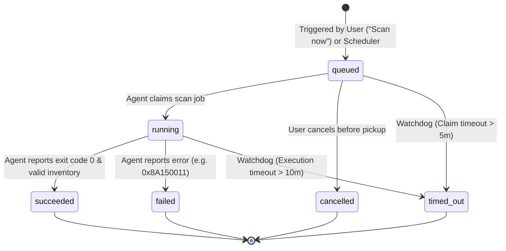
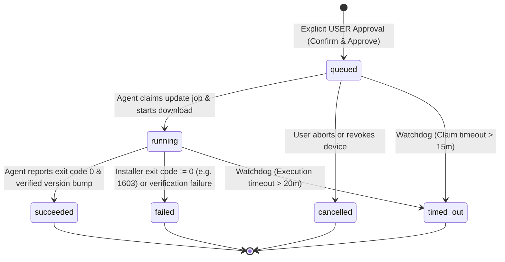

# UpdatePilot - Job State Machines & Lifecycle Specification

This document formally defines the state machines, valid state transitions, trigger actors, and concurrency rules for **Scan Jobs** and **Update Jobs** in UpdatePilot.

---

## 1. State Machine Definitions

Both scan and update jobs transition across six standardized lifecycle states:

| State | Classification | Description |
| :--- | :---: | :--- |
| **`queued`** | Active | Job has been created and registered in the database; waiting for the Windows agent to poll and claim it. |
| **`running`** | Active | The Windows agent has claimed the job and is actively executing the subprocess command on the host. |
| **`succeeded`** | Terminal | Subprocess completed with exit code `0` (`S_OK`) and post-execution validation confirmed expected outcome. |
| **`failed`** | Terminal | Subprocess exited with non-zero exit code, manifest verification failed, or installer encountered a fatal error. |
| **`cancelled`** | Terminal | The job was explicitly aborted by the user or invalidated due to device revocation before completion. |
| **`timed_out`** | Terminal | The backend watchdog terminated the job after exceeding maximum permitted execution or claim duration. |

---

## 2. Scan Jobs State Machine

Scan jobs execute read-only queries (`winget list` and `winget upgrade`) to catalog host software and detect available upgrades.



### Scan Jobs State Transition Table

| From State | To State | Triggered By | Trigger Event / Condition | Side Effects & Auditing |
| :--- | :--- | :---: | :--- | :--- |
| **`[*]"`** | **`queued`** | **User** / Scheduler | User clicks "Scan now" or scheduled timer fires. | Generates `scan_job` row; broadcasts notification to agent. |
| **`queued`** | **`running`** | **Agent** | Agent polls `/api/v1/agent/jobs`, receives job, and launches `winget`. | Updates `started_at = NOW()`; updates status badge to "Scanning...". |
| **`queued`** | **`cancelled`** | **User** | User aborts the queued scan before agent picks it up. | Writes `audit_events` row (`SCAN_CANCELLED`). |
| **`queued`** | **`timed_out`** | **Watchdog** | Agent has not claimed the job within **5 minutes**. | Flags device as potentially offline; alerts user. |
| **`running`** | **`succeeded`** | **Agent** | Agent parses output, sends inventory payload, and reports exit code 0. | Updates `applications` table; populates `update_previews`; updates `last_scanned_at`. |
| **`running`** | **`failed`** | **Agent** | Subprocess failed (e.g., exit code `0x8A150011` source open failed). | Preserves previous cached inventory; records stderr diagnostic trace. |
| **`running`** | **`timed_out`** | **Watchdog** | Agent subprocess exceeds **10 minutes** or agent heartbeat goes silent. | Marks job `timed_out`; unlocks device scan lock. |

---

## 3. Update Jobs State Machine

Update jobs execute mutative software installations (`winget upgrade --id <Id> --exact`). 
> **Cardinal Non-Negotiable**: An update job can **only** be initialized in `queued` status through an explicit **User** approval action in the dashboard.



### Update Jobs State Transition Table

| From State | To State | Triggered By | Trigger Event / Condition | Side Effects & Auditing |
| :--- | :--- | :---: | :--- | :--- |
| **`[*]"`** | **`queued`** | **User** | Explicit confirmation click in Update Approval modal. | Links `update_preview_id`; writes `UPDATE_APPROVED` to `audit_events`. |
| **`queued`** | **`running`** | **Agent** | Agent fetches pending approved task; launches verified subprocess. | Sets `started_at = NOW()`; locks package from duplicate update attempts. |
| **`queued`** | **`cancelled`** | **User** | User dismisses/rejects update or revokes device credentials. | Invalidates action payload; writes `UPDATE_CANCELLED` to audit log. |
| **`queued`** | **`timed_out`** | **Watchdog** | Agent fails to claim job within **15 minutes** (e.g. host is asleep). | Reverts `update_previews.status` to `PENDING_APPROVAL` with notice. |
| **`running`** | **`succeeded`** | **Agent** | Subprocess exits with code 0 **AND** post-upgrade version query verifies target version. | Updates `applications.installed_version`; archives `update_previews`; logs `UPDATE_COMPLETED`. |
| **`running`** | **`failed`** | **Agent** | Installer exits with non-zero code (e.g. `1603`, `3010`) or version unchanged. | Captures stdout/stderr; preserves current version; writes `UPDATE_FAILED`. |
| **`running`** | **`timed_out`** | **Watchdog** | Installation subprocess runs longer than **20 minutes** (hanging installer). | Flags job as `timed_out`; prompts user with manual recovery steps. |

---

## 4. Invariant Concurrency & Safety Rules

1. **Strictly One Active Update Job per (Device, Package)**:
   - A device cannot have more than one update job in `queued` or `running` state for the same `package_id` simultaneously.
   - Enforced by database constraint and application mutex:
     ```sql
     CREATE UNIQUE INDEX uq_active_update_per_pkg 
     ON update_jobs (device_id, application_id) 
     WHERE status IN ('QUEUED', 'IN_PROGRESS');
     ```

2. **Strictly One Active Scan Job per Device**:
   - A device cannot execute multiple concurrent scans.
   - If a scan is `queued` or `running`, subsequent "Scan now" requests are rejected with `409 Conflict` until the active scan reaches a terminal state.

3. **Mandatory Approval Traceability Gate**:
   - No update job can enter `queued` without an authenticated `user_id` stored in `approved_by_user_id`.
   - The backend API rejects any agent attempt to create an update job autonomously.

4. **Terminal State Immutability**:
   - Once a job enters `succeeded`, `failed`, `cancelled`, or `timed_out`, its state is strictly immutable.
   - Re-running an update generates a fresh `update_jobs` record with a distinct UUID to preserve the audit trail.

5. **Post-Execution Verification Gate**:
   - An update job cannot transition from `running` to `succeeded` solely based on process exit code `0`.
   - The agent must run a verification check (`winget list --id <Id> --exact`) confirming that the installed version matches `target_version` before declaring success.

6. **Watchdog Timeout Matrix**:
   - **Scan Pickup Timeout**: 5 minutes
   - **Scan Execution Timeout**: 10 minutes
   - **Update Pickup Timeout**: 15 minutes
   - **Update Execution Timeout**: 20 minutes (handles large installer downloads)
