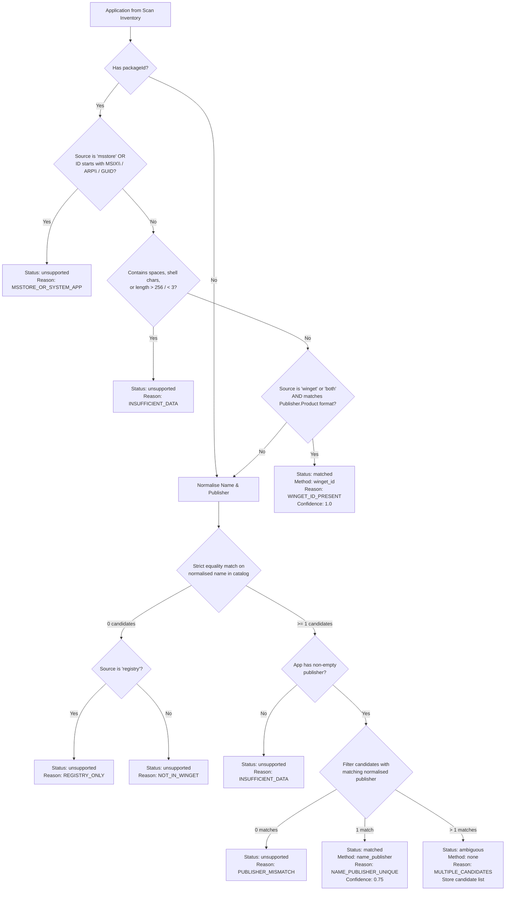

# Package Matching Architecture & Rules

This document describes how UpdatePilot conservatively matches discovered Windows applications to updateable WinGet package identifiers. All matching executes on the backend from stored scan inventory; the Windows agent only reports observed facts.

---

## 1. Matching Rules Flowchart

---

## 2. Match Reason Codes Reference

Every application row in the database has a deterministic `matchStatus`, a machine-readable `matchReason`, a human-readable message, and a suggested next step. Unsupported states are normal, informative inventory states rather than errors.

| Reason Code | Match Status | Method | Confidence | Explanation | Suggested Next Step |
| :--- | :--- | :--- | :---: | :--- | :--- |
| `WINGET_ID_PRESENT` | `matched` | `winget_id` | `1.0` | Verified WinGet `Publisher.Product` identifier reported directly by WinGet on the device. | Updates can be queried and approved through WinGet. |
| `NAME_PUBLISHER_UNIQUE` | `matched` | `name_publisher` | `0.75` | Exactly one catalog package matched both the normalised application name and normalised publisher. | Updates can be evaluated against the matched catalog package. |
| `MULTIPLE_CANDIDATES` | `ambiguous` | `none` | `null` | Multiple distinct catalog packages matched the normalised name and publisher. | Review the read-only candidate list in Application Details. |
| `PUBLISHER_MISMATCH` | `unsupported` | `none` | `null` | Application name matched a catalog package, but publisher metadata disagreed. | Confirm whether this software came from an alternate vendor. |
| `NO_PACKAGE_ID` | `unsupported` | `none` | `null` | Discovered without a package identifier or recognizable signature. | Inventory is tracked; update manually via vendor installer. |
| `NOT_IN_WINGET` | `unsupported` | `none` | `null` | No matching manifest exists in the configured package catalog. | Update manually or check if the vendor publishes a WinGet manifest. |
| `REGISTRY_ONLY` | `unsupported` | `none` | `null` | Discovered exclusively in Windows Uninstall registry without WinGet metadata. | No action required; update manually using vendor installer. |
| `MSSTORE_OR_SYSTEM_APP` | `unsupported` | `none` | `null` | Managed by Microsoft Store (`msstore`), MSIX, or Windows system components. | Use Microsoft Store or Windows Update to manage updates. |
| `INSUFFICIENT_DATA` | `unsupported` | `none` | `null` | Missing publisher, malformed identifier, or rejected shell characters. | Ensure application is cleanly installed and detected in ARP. |
| `PENDING` | `pending` | `none` | `null` | Newly discovered and awaiting backend catalog matching. | Matching executes automatically at the end of the scan. |

---

## 3. Why Matching is Conservative

UpdatePilot enforces strict conservative matching because **a false positive match could cause `winget upgrade` to install or overwrite the wrong software on a user's machine**:

1. **Exact WinGet ID First**: An exact `Publisher.Product` ID reported by `winget list` on the host is the strongest evidence (`1.0` confidence). Any ID containing spaces, shell metacharacters (`;`, `&`, `|`, `$`, `` ` ``, etc.), or exceeding 256 characters is immediately rejected as `INSUFFICIENT_DATA`.
2. **Strict Equality, Never Substring Matching**: Name matching normalises away version numbers, architecture markers (`x64`, `64-bit`), edition words (`Community`, `Enterprise`), and punctuation, then compares via strict string equality (`===`). Partial or "contains" matching is never used, preventing lookalikes (e.g., `Git GUI` vs `Git`, or `Postman Agent` vs `Postman`) from colliding.
3. **Mandatory Publisher Agreement**: Name matches alone are insufficient; the normalised publisher (stripping corporate suffixes like `Inc`, `LLC`, `Corp`, `GmbH`) must also agree.
4. **Ambiguity Halts Automation**: If more than one package shares the same normalised name and publisher (e.g., `Oracle.JDK.23` vs `Oracle.JDK.25`), the app is marked `ambiguous` (`Needs review`) and excluded from automated updates.
5. **Updates Screen Enforcement**: Only `matched` applications are ever offered on the Software Updates approval screen.

---

## 4. Known Limitations

- **Seeded Catalog Coverage**: Fallback name/publisher matching relies on the backend's cached/seeded known-packages catalog. Apps not yet in the catalog are classified as `NOT_IN_WINGET` or `REGISTRY_ONLY` until the catalog is refreshed and `POST /api/devices/:id/rematch` is run.
- **Localized Display Names**: Registry display names in non-English Windows installations may not match English catalog entries.
- **Microsoft Store & MSIX Apps**: Store-managed (`msstore`) and `MSIX\` / `ARP\` system entries are intentionally marked `MSSTORE_OR_SYSTEM_APP` (`Not supported`) in this MVP.
- **Read-Only Ambiguous Candidates**: Ambiguous applications display their candidate list in Application Details for transparency, but manual candidate selection is deferred to a future release.
