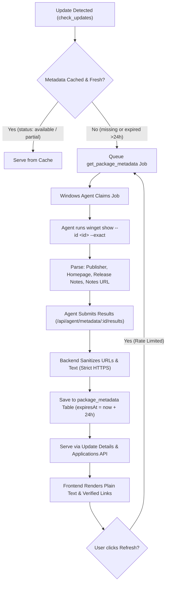

# Package Release Metadata, Source Links & Caching

## 1. Overview

UpdatePilot enriches software updates with verified official publisher source links, release notes, and version information. This empowers administrators and end users to review what changes are in an update before granting explicit authorization at the approval gate.

To ensure performance, responsiveness, and minimal external network calls, metadata is cached in a centralized PostgreSQL cache with a configurable **24-hour Time-To-Live (TTL)**.

---

## 2. End-to-End Workflow



---

## 3. Core Safety Rules & Invariants

1. **Strictly Read-Only Execution**:
   - Metadata is queried solely via `winget show --id <id> --exact --accept-source-agreements --disable-interactivity`.
   - Never runs installers, download scripts, or update commands.
   - Command arguments are executed as a list (`shell=False`) with a strict per-package timeout (15s) and job batch ceiling (max 20 packages per execution).

2. **Strict HTTPS Validation & Sanitization**:
   - Only URLs beginning with the `https://` protocol are stored and rendered as clickable links.
   - Any `http:`, `javascript:`, `data:`, `file:`, or `blob:` protocols are rejected and stripped.
   - User credentials embedded in URLs (`username:password@`) are stripped.
   - URL length is capped at 2,048 characters.
   - URLs containing control characters or whitespace are dropped.

3. **Plain Text Only (Zero HTML / No XSS)**:
   - Release notes and publisher descriptions are treated as untrusted text.
   - Control characters are stripped (retaining standard line breaks `\n` and tabs `\t`).
   - Text is normalized (`\r\n` &rarr; `\n`) and truncated safely to 16,384 characters.
   - Rendered on the frontend strictly as plain text (inside `<pre className="release-notes-pre">` or whitespace-preserving text containers). `dangerouslySetInnerHTML` is prohibited.

4. **No Hallucination / Clear Missing States**:
   - The system never guesses or synthesizes release notes, URLs, or publishers.
   - When upstream publishers do not provide notes or links, the UI displays human-readable fallback notices:
     - `"Official source link not provided by the publisher"`
     - `"Release notes not provided by the publisher"`
     - `"Information last updated 3 hours ago"`

---

## 4. Metadata Cache Lifecycle & Statuses

Each cached record in the `package_metadata` table tracks `(packageId, version, publisher, homepageUrl, releaseNotesUrl, releaseNotesSummary, fetchStatus, fetchedAt, expiresAt)`.

The metadata lifecycle is defined by four distinct statuses:

| Status | Condition | Human Message / UI Behavior |
| :--- | :--- | :--- |
| `available` | Fresh cache record exists (`expiresAt > now`), with both official source link and release notes present. | Full release information rendered with verified source link and release notes. |
| `partial` | Fresh cache record exists (`expiresAt > now`), but lacks either the official source link or release notes. | Displays present items; shows explicit fallback notice for missing items. |
| `missing` | No cache record exists for this package version or agent recorded `fetch_status: "failed"`. | Shows `"Metadata not available for this package version"` with option to refresh. |
| `stale` | Cache record exists but is expired (`expiresAt <= now`, older than 24 hours). | Displays cached information with stale notice: `"Information is stale and awaiting refresh"`. |

---

## 5. REST API Endpoints

### 5.1 Update Details API
- **Endpoint**: `GET /api/devices/:id/updates/:updateId` (alias: `GET /api/devices/:id/applications/:appId`)
- **Auth**: User JWT (`requireAuth`), device ownership enforced.
- **Response**:
```json
{
  "success": true,
  "data": {
    "id": "app-git-1",
    "deviceId": "dev-1",
    "name": "Git for Windows",
    "packageId": "Git.Git",
    "currentVersion": "2.44.0",
    "targetVersion": "2.56.0",
    "publisher": "The Git Community",
    "officialSourceLink": "https://git-scm.com/",
    "releaseNotesLink": "https://github.com/git-for-windows/git/releases/tag/v2.56.0",
    "releaseNotesSummary": "* Fixed CVE-2026-0001\n* Performance improvements",
    "fetchedAt": "2026-11-17T11:00:00.000Z",
    "metadataStatus": "available",
    "status": "available",
    "missingMessages": {},
    "releaseInfo": { ... }
  }
}
```

### 5.2 Manual Metadata Refresh
- **Endpoint**: `POST /api/devices/:id/metadata-refresh`
- **Auth**: User JWT (`requireAuth`), owner only.
- **Audit**: Writes `METADATA_REFRESH_REQUESTED` audit event.
- **Rate Limit**: Enforces a 10-second cooldown per device. Returns `429 Too Many Requests` (`Retry-After: <sec>`) if repeated rapidly.
- **Payload** *(optional)*: `{ "packageId": "Git.Git" }` (refreshes specific package or all update-available packages).
- **Response**: `201 Created` with queued scan job details.

### 5.3 Submit Agent Results
- **Endpoint**: `POST /api/agent/metadata/:id/results`
- **Auth**: Agent Device Token (`requireAgent`).
- **Body Limit**: 2MB, validated via Zod schema.
- **Behavior**: Sanitizes URLs and plain text, upserts into `package_metadata` with 24h TTL, transitions `scanJob.status` to `succeeded`, and writes `METADATA_JOB_SUCCEEDED` audit event.

---

## 6. Frontend Presentation

- **Source Links**: Rendered with `target="_blank" rel="noopener noreferrer"`, displaying the extracted domain name/hostname (e.g., `git-scm.com ↗`).
- **Release Notes**: Rendered in a monospace pre-formatted box with keyboard accessibility (`tabIndex={0}`, `role="region"`).
- **Freshness**: Relative time indicator (`"Information last updated 3 hours ago"` or `"Information last updated just now"`).
- **Refresh Action**: On-demand Refresh button with live spinner and rate-limit feedback.
