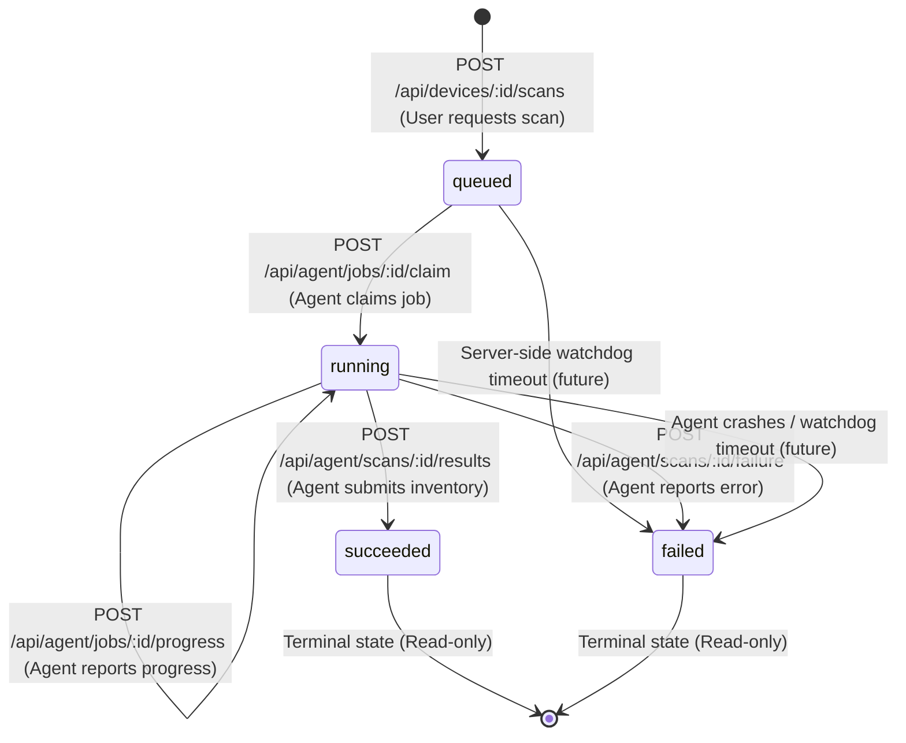

# Scan Flow Architecture & Job Lifecycle

This document specifies the end-to-end scan lifecycle in UpdatePilot, detailing communication between the Web Dashboard frontend, the Backend API, the PostgreSQL Database, and the local Windows Agent.

---

## 1. End-to-End Scan Sequence Flow

The following sequence diagram outlines the entire workflow from user initiation to dashboard presentation:

```mermaid
sequenceDiagram
    autonumber
    actor User as Dashboard User
    participant Frontend as Frontend (React UI)
    participant Backend as Backend API (Express)
    participant DB as PostgreSQL (Prisma)
    participant Agent as Windows Agent (Python)

    %% Scan Trigger
    User->>Frontend: Clicks "Scan now"
    Frontend->>Backend: POST /api/devices/:id/scans (Bearer User JWT)
    Backend->>DB: Check device ownership & active scans
    alt Active scan exists (status: queued | running)
        Backend-->>Frontend: 409 Conflict { code: "ACTIVE_SCAN_EXISTS", existingJobId }
        Frontend->>Frontend: Switch to polling existing active scan
    else No active scan
        Backend->>DB: INSERT scan_jobs (status: "queued") & audit_events (SCAN_QUEUED)
        Backend-->>Frontend: 201 Created { job: { id, status: "queued" } }
    end

    %% Frontend Polling Starts
    loop Every 2 seconds (until terminal or tab hidden)
        Frontend->>Backend: GET /api/devices/:id/scans/:jobId
        Backend->>DB: SELECT scan_jobs WHERE id = :jobId
        DB-->>Backend: Job Record
        Backend-->>Frontend: 200 OK { job: { status, progressPercent, progressStep } }
        Frontend->>Frontend: Update live progress bar & step indicator
    end

    %% Agent Polling & Claiming
    loop Periodic polling (default: 10s + jitter)
        Agent->>Backend: GET /api/agent/jobs (Bearer Agent Token)
        Backend->>DB: Hash agent token, verify device identity
        Backend->>DB: SELECT oldest queued scan_jobs WHERE deviceId = :devId
        DB-->>Backend: scan_jobs record
        Backend-->>Agent: 200 OK { jobs: [{ id, type: "scan_inventory" }] }
    end

    Agent->>Agent: Verify job type is on allow-list ("scan_inventory")
    Agent->>Backend: POST /api/agent/jobs/:id/claim (Bearer Agent Token)
    Backend->>DB: UPDATE scan_jobs SET status = 'running', startedAt = NOW() WHERE id = :id AND status = 'queued'
    alt Claim successful (1 row updated)
        Backend-->>Agent: 200 OK { job: { status: "running" } }
    else Already claimed / terminal
        Backend-->>Agent: 409 Conflict { code: "CLAIM_CONFLICT" }
    end

    %% Agent Execution & Progress
    Agent->>Agent: Execute scan_inventory (WinGet + Registry inspection)
    opt Throttled live progress (at most every 2s)
        Agent->>Backend: POST /api/agent/jobs/:id/progress { percent, step }
        Backend->>DB: UPDATE scan_jobs SET progressPercent, progressStep WHERE status = 'running'
        Backend-->>Agent: 200 OK
    end

    %% Scan Result Submission
    alt Scan Succeeded
        Agent->>Backend: POST /api/agent/scans/:id/results (Payload: discovered_packages <= 5000)
        Backend->>Backend: Validate payload via Zod schema & enforce 2MB limit
        Backend->>DB: BEGIN TRANSACTION
        Backend->>DB: Upsert applications (match by packageId or name)
        Backend->>DB: Mark unseen applications for device as isInstalled = false
        Backend->>DB: UPDATE scan_jobs (status = "succeeded", finishedAt = NOW(), appCount)
        Backend->>DB: UPDATE devices (lastSeenAt = NOW())
        Backend->>DB: INSERT audit_events (SCAN_SUCCEEDED)
        Backend->>DB: COMMIT TRANSACTION
        Backend-->>Agent: 200 OK { jobId, appCount, status: "succeeded" }
    else Scan Failed (both sources failed or unexpected exception)
        Agent->>Backend: POST /api/agent/scans/:id/failure { error_code, error_message }
        Backend->>DB: UPDATE scan_jobs SET status = 'failed', finishedAt = NOW(), errorCode, errorMessage
        Backend->>DB: INSERT audit_events (SCAN_FAILED)
        Backend-->>Agent: 200 OK { jobId, status: "failed" }
    end

    %% Frontend Final Update
    Frontend->>Backend: GET /api/devices/:id/scans/:jobId
    Backend-->>Frontend: 200 OK { job: { status: "succeeded", appCount: N } }
    Frontend->>Frontend: Stop polling; trigger cache invalidation
    Frontend->>Backend: Refetch Applications, Overview cards & History
    Backend-->>Frontend: Updated Inventory & Metrics
    Frontend->>User: Displays "Found N applications" & fresh inventory
```

---

## 2. Job State Machine

The scan job state transitions follow a strictly monotonic lifecycle as specified below:



### Transition Invariants
1. **Monotonicity**: Terminal states (`succeeded`, `failed`) can **never** transition back to `queued` or `running`. Attempting to submit results or claims against a terminal job returns `HTTP 409 Conflict`.
2. **Concurrency Barrier**: At most **one** active (`queued` or `running`) scan job may exist for a device at any point in time. A second request returns `HTTP 409 Conflict` containing `existingJobId`.
3. **Atomic Claim**: Claiming transitions `queued` to `running` using conditional database updates (`WHERE id = :id AND status = 'queued'`). If two processes attempt to claim simultaneously, exactly one succeeds and the other receives `HTTP 409 Conflict`.

---

## 3. Validation Limits and Safety Controls

UpdatePilot treats all agent-submitted scan data as untrusted input. The following validation and safety controls are enforced at every boundary:

### 3.1 HTTP Body Limits
- **Results Route Ceiling**: Dedicated Express JSON middleware restricts `POST /api/agent/scans/:id/results` to **2MB**. Excessively large payloads are rejected upfront with `HTTP 413 Payload Too Large`.

### 3.2 Zod Schema Constraints
The backend validates incoming scan payloads using strict Zod schemas:
| Field | Type | Maximum Length / Value | Notes |
| :--- | :--- | :--- | :--- |
| `discovered_packages` | Array | 5,000 items | Prevents denial-of-service via unbounded arrays |
| `name` | String | 1 - 256 characters | Sanitized package name |
| `package_id` | String | Max 256 characters | Normalized WinGet / Registry ID |
| `installed_version` | String | 1 - 128 characters | Version identifier string |
| `available_version` | String (nullable) | Max 128 characters | Upgrade candidate version |
| `publisher` | String (nullable) | Max 256 characters | Application publisher / vendor |
| `source` | String (nullable) | Max 50 characters | `winget`, `registry`, or `both` |
| `is_managed` | Boolean | - | Indicates whether package has WinGet upgrade candidate |
| `raw_stderr` | String (optional) | Max 4,096 characters | Capped diagnostic output |
| `warnings` | Array | Max 100 items (each max 500 chars) | Operational warnings |
| `error_message` | String (failure route) | Max 500 characters | Safe error message without tokens or paths |

### 3.3 Strict Device & Agent Isolation
- **Authentication**: Agents authenticate via high-entropy device tokens. Plaintext tokens are **never** stored in the database; lookup is performed strictly against `SHA-256(token)`.
- **Ownership Verification**: Every agent endpoint (`/jobs`, `/claim`, `/progress`, `/results`, `/failure`) strictly validates that `job.deviceId === authenticatedDevice.id`. Agents cannot inspect or modify jobs belonging to any other device (`HTTP 404 Not Found`).
- **User Ownership**: Dashboard users can only initiate scans and query data for devices they own. Cross-tenant queries return `HTTP 404 Not Found`.

### 3.4 Atomic Database Transactions
All inventory synchronization is wrapped in a single database transaction (`prisma.$transaction`):
- Existing applications are matched by `(deviceId, packageId.toLowerCase())` or `(deviceId, name.toLowerCase())`.
- Matched applications are updated; new applications are created.
- Applications previously recorded for this device that are **not** present in the current scan payload are updated to `isInstalled = false` (historical records are preserved).
- The scan job status is updated to `succeeded` with `finishedAt` and `appCount`.
- Device `lastSeenAt` is updated.
- An immutable `audit_events` row (`SCAN_SUCCEEDED`) is inserted.
- If **any** operation in this sequence fails, the entire transaction rolls back cleanly, leaving zero orphaned or partially updated data.

### 3.5 Log Hygiene & Privacy
- Full application inventory lists are never logged by the agent or backend.
- Plaintext device tokens, pairing codes, and password hashes are never logged.
- Progress and failure logs record only job IDs, state names, timings, and package counts.
