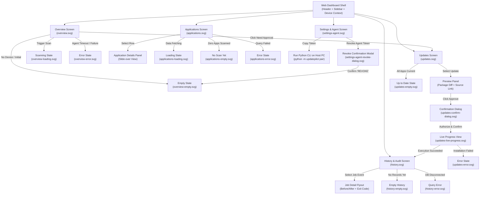

# UpdatePilot - Wireframes & UI Navigation Architecture

This directory houses the complete low-fidelity UI/UX wireframes for the **UpdatePilot Web Dashboard**. Every state has been drawn as an accessible, standalone SVG with realistic data models based on real WinGet environment fixtures.

---

## 1. UI Navigation Architecture

The following Mermaid diagram maps the user journeys, state transitions, modals, and flyout views across the application:

---

## 2. Complete Wireframes Inventory

| Screen / Component | Artifact Link | State | Key Features Depicted |
| :--- | :--- | :--- | :--- |
| **Overview** | [overview.svg](file:///c:/Users/Dinusha/Desktop/INTERN%20DOC/Project%201/Update_Pilot/docs/wireframes/overview.svg) | Standard | 5 summary cards (Total Apps, Updates, Unsupported, Last Scan, Agent Status), recent activity feed, quick pending approvals table. |
| **Overview** | [overview-loading.svg](file:///c:/Users/Dinusha/Desktop/INTERN%20DOC/Project%201/Update_Pilot/docs/wireframes/overview-loading.svg) | Loading | Progress banner, active spinner on "Scan now", skeleton cards and rows. |
| **Overview** | [overview-empty.svg](file:///c:/Users/Dinusha/Desktop/INTERN%20DOC/Project%201/Update_Pilot/docs/wireframes/overview-empty.svg) | Empty | Onboarding illustration, zero-state metrics, pairing instructions with token generator. |
| **Overview** | [overview-error.svg](file:///c:/Users/Dinusha/Desktop/INTERN%20DOC/Project%201/Update_Pilot/docs/wireframes/overview-error.svg) | Error | Red alert banner (`0x8A150011 Source Open Failed`), agent disconnection card, terminal stderr diagnostics. |
| **Applications** | [applications.svg](file:///c:/Users/Dinusha/Desktop/INTERN%20DOC/Project%201/Update_Pilot/docs/wireframes/applications.svg) | Standard | Search input, status & source filters, sortable table, pagination, status badges, and slide-over Application Details panel. |
| **Applications** | [applications-loading.svg](file:///c:/Users/Dinusha/Desktop/INTERN%20DOC/Project%201/Update_Pilot/docs/wireframes/applications-loading.svg) | Loading | Skeleton search & filters, 8 full-width skeleton table rows, disabled pagination. |
| **Applications** | [applications-empty.svg](file:///c:/Users/Dinusha/Desktop/INTERN%20DOC/Project%201/Update_Pilot/docs/wireframes/applications-empty.svg) | Empty | Zero-inventory illustration, "Run Initial Scan" CTA, safety assurance note. |
| **Applications** | [applications-error.svg](file:///c:/Users/Dinusha/Desktop/INTERN%20DOC/Project%201/Update_Pilot/docs/wireframes/applications-error.svg) | Error | Database query timeout banner (HTTP 504), raw trace ID, retry button. |
| **Updates** | [updates.svg](file:///c:/Users/Dinusha/Desktop/INTERN%20DOC/Project%201/Update_Pilot/docs/wireframes/updates.svg) | Standard | Pending updates table, version diff badges, Preview panel with source link, target host, planned agent command. |
| **Updates** | [updates-confirm-dialog.svg](file:///c:/Users/Dinusha/Desktop/INTERN%20DOC/Project%201/Update_Pilot/docs/wireframes/updates-confirm-dialog.svg) | Modal | Centered approval dialog, invariant enforcement notice, authorization checkbox, explicit confirmation. |
| **Updates** | [updates-live-progress.svg](file:///c:/Users/Dinusha/Desktop/INTERN%20DOC/Project%201/Update_Pilot/docs/wireframes/updates-live-progress.svg) | Live | 5-step execution tracker, live terminal stdout stream from WinGet, elapsed timer. |
| **Updates** | [updates-empty.svg](file:///c:/Users/Dinusha/Desktop/INTERN%20DOC/Project%201/Update_Pilot/docs/wireframes/updates-empty.svg) | Empty | "Everything is Up to Date" green shield, last scanned badge, check for updates button. |
| **Updates** | [updates-error.svg](file:///c:/Users/Dinusha/Desktop/INTERN%20DOC/Project%201/Update_Pilot/docs/wireframes/updates-error.svg) | Error | Installation failure banner (`Exit Code 1603`), subprocess stderr capture, resolution steps, retry action. |
| **History** | [history.svg](file:///c:/Users/Dinusha/Desktop/INTERN%20DOC/Project%201/Update_Pilot/docs/wireframes/history.svg) | Standard | Job list with filters (Type, Status, Date), status badges, Detail panel with Before/After versions and exit codes. |
| **History** | [history-empty.svg](file:///c:/Users/Dinusha/Desktop/INTERN%20DOC/Project%201/Update_Pilot/docs/wireframes/history-empty.svg) | Empty | No history records illustration, audit policy description, initial scan trigger. |
| **History** | [history-error.svg](file:///c:/Users/Dinusha/Desktop/INTERN%20DOC/Project%201/Update_Pilot/docs/wireframes/history-error.svg) | Error | Database connection error banner (Prisma P1001), diagnostic snippet, retry button. |
| **Settings / Agent** | [settings-agent.svg](file:///c:/Users/Dinusha/Desktop/INTERN%20DOC/Project%201/Update_Pilot/docs/wireframes/settings-agent.svg) | Standard | Pairing code display with expiry countdown (12:45), live agent telemetry, operational preferences, Danger Zone. |
| **Settings / Agent** | [settings-agent-revoke-dialog.svg](file:///c:/Users/Dinusha/Desktop/INTERN%20DOC/Project%201/Update_Pilot/docs/wireframes/settings-agent-revoke-dialog.svg) | Modal | Destructive revocation confirmation dialog, warning checklist, text validation prompt (`REVOKE`). |

---

## 3. MVP Workflow Completion Checklist

This checklist verifies that all 7 primary workflows defined in [docs/requirements.md](file:///c:/Users/Dinusha/Desktop/INTERN%20DOC/Project%201/Update_Pilot/docs/requirements.md) can be completed through these wireframes:

| Workflow ID | Workflow Name | Corresponding Wireframe(s) | How the Screen Fulfills the Workflow | Status |
| :---: | :--- | :--- | :--- | :---: |
| **WF-1** | **User Login & Session** | Global Header in all SVGs | Renders active user avatar badge (`DU`), session status, and authenticated device context. | **Covered** |
| **WF-2** | **Pair a Device** | [settings-agent.svg](file:///c:/Users/Dinusha/Desktop/INTERN%20DOC/Project%201/Update_Pilot/docs/wireframes/settings-agent.svg), [overview-empty.svg](file:///c:/Users/Dinusha/Desktop/INTERN%20DOC/Project%201/Update_Pilot/docs/wireframes/overview-empty.svg) | Displays generated one-time token, 15-minute live expiration countdown, copy button, and exact CLI pairing command. | **Covered** |
| **WF-3** | **Run a Scan** | Header on all screens, [overview-loading.svg](file:///c:/Users/Dinusha/Desktop/INTERN%20DOC/Project%201/Update_Pilot/docs/wireframes/overview-loading.svg), [applications-empty.svg](file:///c:/Users/Dinusha/Desktop/INTERN%20DOC/Project%201/Update_Pilot/docs/wireframes/applications-empty.svg) | Dedicated **"Scan now"** button triggers non-mutating `winget list` & `winget upgrade` inspection with real-time progress indicators. | **Covered** |
| **WF-4** | **View Available Updates** | [overview.svg](file:///c:/Users/Dinusha/Desktop/INTERN%20DOC/Project%201/Update_Pilot/docs/wireframes/overview.svg), [updates.svg](file:///c:/Users/Dinusha/Desktop/INTERN%20DOC/Project%201/Update_Pilot/docs/wireframes/updates.svg), [applications.svg](file:///c:/Users/Dinusha/Desktop/INTERN%20DOC/Project%201/Update_Pilot/docs/wireframes/applications.svg) | Summary card displays pending count (`33`); table sorts and filters packages; status badges indicate version deltas. | **Covered** |
| **WF-5** | **Preview & Approve Update** | [updates.svg](file:///c:/Users/Dinusha/Desktop/INTERN%20DOC/Project%201/Update_Pilot/docs/wireframes/updates.svg), [updates-confirm-dialog.svg](file:///c:/Users/Dinusha/Desktop/INTERN%20DOC/Project%201/Update_Pilot/docs/wireframes/updates-confirm-dialog.svg) | Side panel renders package diff, source manifest link, and target host; confirmation modal enforces explicit approval. | **Covered** |
| **WF-6** | **Live Execution & Verification** | [updates-live-progress.svg](file:///c:/Users/Dinusha/Desktop/INTERN%20DOC/Project%201/Update_Pilot/docs/wireframes/updates-live-progress.svg), [updates-error.svg](file:///c:/Users/Dinusha/Desktop/INTERN%20DOC/Project%201/Update_Pilot/docs/wireframes/updates-error.svg) | 5-step stepper tracks live agent installation; terminal stream captures WinGet output; post-verification confirms version bump. | **Covered** |
| **WF-7** | **View History & Audit Logs** | [history.svg](file:///c:/Users/Dinusha/Desktop/INTERN%20DOC/Project%201/Update_Pilot/docs/wireframes/history.svg) | Multi-criteria filters (type, status, date); detail panel displays before/after versions, exit code, duration, and stdout capture. | **Covered** |
| **WF-8** | **Revoke an Agent** | [settings-agent.svg](file:///c:/Users/Dinusha/Desktop/INTERN%20DOC/Project%201/Update_Pilot/docs/wireframes/settings-agent.svg), [settings-agent-revoke-dialog.svg](file:///c:/Users/Dinusha/Desktop/INTERN%20DOC/Project%201/Update_Pilot/docs/wireframes/settings-agent-revoke-dialog.svg) | Danger zone card with consequence checklist; confirmation modal requires typing `REVOKE` before invalidating device tokens. | **Covered** |
